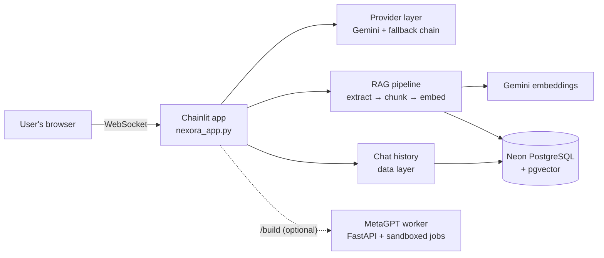

<div align="center">

# Nexora-AI

**An AI assistant that answers questions about your own documents, with cited sources.**
Built with Python, Chainlit, Google Gemini, PostgreSQL + pgvector, and MetaGPT. Deployed for ₹0/month.

[](https://nexora-ai-jcdz.onrender.com)
[](https://github.com/rashmitha-j/Nexora-AI)

[](https://github.com/rashmitha-j/Nexora-AI/actions/workflows/ci.yml)


[](LICENSE)


<sub>Real screenshot: a document is uploaded, indexed into pgvector, and Gemini answers with a citation.<br>
The live demo runs on Render's free plan, so the first visit after a quiet period can take about a minute to wake up.</sub>

</div>

---

## At a glance

| | |
|---|---|
| **What it is** | A public, production-deployed generative-AI web app: streaming chat, document Q&A with citations (RAG), and a multi-agent "build me a project" workflow |
| **Why it matters** | Generic chatbots can't answer from *your* files, and a public AI app must survive free-tier quotas and abuse. Nexora-AI handles both |
| **Tech** | Python 3.11 · Chainlit · Google Gemini · PostgreSQL / pgvector (Neon) · asyncpg · MetaGPT · FastAPI · pytest · ruff · GitHub Actions · Render |
| **Scale of work** | ~1,800 lines of application code, ~400 lines for the agent worker, ~650 lines of tests (57 automated tests, all passing in CI) |
| **Status** | Live at **https://nexora-ai-jcdz.onrender.com**: chat and document Q&A verified in production |

## Key features

- **Document Q&A with citations (RAG).** Upload a PDF, TXT, MD, CSV or JSON file and ask about it. Answers are grounded in the most relevant passages and cite them as `[1]`, `[2]`.
- **Streaming AI chat.** Answers appear token by token from Google Gemini. A provider layer also supports Anthropic Claude, OpenAI and local Ollama models.
- **Keeps working when free quotas run out.** It automatically falls back across six Gemini models when one hits its daily limit or is overloaded.
- **Private by design.** Each user's (or each anonymous chat's) documents are isolated. Anonymous uploads are deleted when the chat ends or after 24 hours.
- **Optional sign-in and chat history.** Password login (PBKDF2), saved conversations in PostgreSQL, and resuming old chats with their context.
- **Multi-agent workflow.** `/build <idea>` sends a MetaGPT team (product manager → architect → project manager → engineer) to a sandboxed worker that returns a generated project.
- **Hardened for public use.** Rate limits, request-size limits, a model allow-list, timeouts and safe error messages throughout.

## Skills demonstrated

| Area | Evidence in this project |
|---|---|
| **Generative AI / LLM engineering** | RAG pipeline (chunking, embeddings, vector search, grounded prompts with citations), streaming, multi-provider abstraction, prompt-injection hardening |
| **Backend engineering** | Async Python (asyncio, asyncpg), connection pooling, idempotent schema migrations, robust error handling, timeouts and retries with backoff |
| **Databases** | PostgreSQL + pgvector with cosine similarity search and HNSW indexing, owner-scoped queries, Neon serverless Postgres |
| **Multi-agent systems** | MetaGPT integration in an isolated FastAPI worker with a job queue, per-job sandboxes, timeouts and approval before running |
| **Security** | Password hashing, login throttling, per-IP and global rate limiting, input validation, parameterized SQL, no client-controlled model choice, secrets kept out of code |
| **DevOps and quality** | GitHub Actions CI (lint + 57 tests), mocked tests that need no API keys, cloud deployment on Render, production debugging from logs |

## Engineering challenges I solved

Real problems found while building and deploying this app, and how each was fixed:

| Problem | Root cause | Solution |
|---|---|---|
| Live site showed a **blank page** (HTTP 500) | Chainlit silently switches on its own database layer when `DATABASE_URL` exists; it needed `asyncpg` and tables it never creates | Wrote a custom data layer that creates its schema safely, works with Neon's connection pooler, and **keeps chat working even if the database is down** |
| PDF upload failed only in production | PDF text extraction produced NUL characters, which PostgreSQL rejects | Reproduced it locally against a real Postgres, then cleaned control characters during extraction; added tests |
| Chat failed when the **free Gemini quota** ran out | Each model has its own daily quota; the last fallback was also overloaded (HTTP 503) | Smart fallback: skip models whose daily quota is used up until their reset time, skip overloaded models immediately, and only retry errors that are truly temporary |
| **Abuse risk** on a public AI endpoint | A free-text model field let anyone choose any (costlier) model; rate limits reset with every new chat | Server-side model allow-list, per-IP plus site-wide rate limits, one request at a time per chat |
| Uploads could **hang for minutes** | SDK default retries (5 × 60 s) and unbounded database waits | Removed hidden retries and added time limits to every stage, so users always get an answer or a clear error |
| MetaGPT 1.0 **wouldn't run the pipeline** with Gemini | Its Gemini client dropped system prompts; a "quick think" shortcut skipped the agents; an LLM-chosen path escaped the sandbox | Routed Gemini through its OpenAI-compatible API, disabled the shortcut, and contained every job to its own workspace (no changes to MetaGPT itself) |

## Architecture



**How a document question is answered:**
1. The uploaded file's text is extracted and cleaned.
2. It's split into ~1,200-character chunks.
3. Each chunk is embedded with `gemini-embedding-001` (768 dimensions) and stored in pgvector under the owner's ID.
4. The question is embedded, and the most similar chunks *for that owner only* are retrieved.
5. Gemini answers using those chunks, which are marked as untrusted reference text, and cites them.

## Screenshots

| Welcome screen | Model choice limited to approved models | Mobile layout |
|---|---|---|
|  |  |  |

## Tech stack

| Layer | Technology |
|---|---|
| Frontend + server | [Chainlit](https://chainlit.io) 2.12 (Python 3.11) |
| AI models | Google Gemini (`google-genai`); optional Anthropic Claude, OpenAI, Ollama |
| Embeddings / vector search | `gemini-embedding-001`, PostgreSQL `pgvector` (HNSW, cosine distance) |
| Database | Neon serverless PostgreSQL via `asyncpg` |
| Multi-agent | [MetaGPT](https://github.com/FoundationAgents/MetaGPT) 1.0 in a FastAPI worker |
| Testing and CI | pytest, ruff, GitHub Actions |
| Hosting | Render (free web service) |

## Quick start

Prerequisites: Python 3.11, Git and a free [Gemini API key](https://aistudio.google.com/apikey).

```bash
git clone https://github.com/rashmitha-j/Nexora-AI.git
```

```bash
cd Nexora-AI
```

```bash
py -3.11 -m venv .venv
```

```bash
.\.venv\Scripts\activate
```

```bash
pip install -r requirements-dev.txt
```

```bash
copy .env.example .env
```

Put your key in `.env` as `GEMINI_API_KEY=...`, then start the app:

```bash
chainlit run nexora_app.py
```

Open http://localhost:8000. On macOS or Linux, use `python3.11 -m venv .venv`, `source .venv/bin/activate` and `cp .env.example .env`. Document Q&A also needs a PostgreSQL database with pgvector in `DATABASE_URL` (a free one from [Neon](https://console.neon.tech) works).

## Project structure

```
Nexora-AI/
├── nexora_app.py            # Chainlit entry point: chat, uploads, commands, limits
├── nexora/
│   ├── providers.py         # LLM providers, error handling, retries, model fallback
│   ├── config.py            # Settings from environment variables, with validation
│   ├── auth.py              # Password hashing, accounts, login throttling
│   ├── history.py           # Chat-history data layer (PostgreSQL)
│   ├── limits.py            # Rate limiter
│   └── rag/                 # ingest.py · embeddings.py · store.py (pgvector) · service.py
├── worker/                  # MetaGPT job worker (FastAPI, queue, sandboxed runner)
├── tests/                   # 57 automated tests + PostgreSQL integration tests
├── docs/screenshots/        # Images used in this README
├── .github/workflows/ci.yml # CI: lint + tests on every push
├── render.yaml              # Render deployment settings
└── .env.example             # All settings, placeholders only
```

## Project status

| Feature | Status |
|---|---|
| Streaming Gemini chat | ✅ Live, verified in production |
| Automatic model fallback on quota or overload | ✅ Live, verified in production |
| Document upload and cited answers (PDF verified) | ✅ Live, verified in production |
| Rate limits, model allow-list, input limits | ✅ Implemented and tested |
| Sign-in and saved chat history | ✅ Implemented and tested locally (off on the public demo by choice) |
| MetaGPT multi-agent `/build` | 🧪 Runs locally; needs more memory than the free hosting plan, and a full run hasn't completed yet (free-tier API quota) |

---

## Detailed documentation

<details>
<summary><b>Environment variables</b></summary>

All settings are in [`.env.example`](.env.example). Secrets go in `.env` (git-ignored) or the Render dashboard, never in the code.

| Variable | Purpose |
|---|---|
| `GEMINI_API_KEY` | Gemini key (or `ANTHROPIC_API_KEY`, `OPENAI_API_KEY`, `OLLAMA_BASE_URL`) |
| `GEMINI_MODEL`, `GEMINI_FALLBACK_MODELS` | Main model and the models tried after it |
| `DATABASE_URL` | PostgreSQL with pgvector; turns on documents (and history when sign-in is on) |
| `NEXORA_USERS`, `CHAINLIT_AUTH_SECRET` | Sign-in accounts and session secret |
| `RATE_LIMIT_PER_MINUTE`, `GLOBAL_RATE_LIMIT_PER_MINUTE` | Per-visitor and site-wide message limits |
| `MAX_MESSAGE_CHARS`, `MAX_UPLOAD_MB`, `MAX_OUTPUT_TOKENS`, `LLM_TIMEOUT_SECONDS` | Size, length and time limits |
| `METAGPT_WORKER_URL`, `METAGPT_WORKER_TOKEN` | Connection to the optional MetaGPT worker |

</details>

<details>
<summary><b>Gemini quota handling and model fallback</b></summary>

Gemini's free tier limits requests per minute and per day, separately for each model. Each answer tries `GEMINI_MODEL` (default `gemini-3.5-flash`), then `GEMINI_FALLBACK_MODELS` in order (default `gemini-3.8-flash`, `gemini-3.7-flash`, `gemini-3.6-flash`, `gemini-3.5-flash-lite`, `gemini-3.1-flash-lite`).

| Error | What Nexora does |
|---|---|
| Daily quota used up (429, per-day quota) | Skips that model until Google's reported reset time |
| Overloaded (503) | Moves straight to the next model |
| Temporary (other 429s, 500, timeout) | Up to 3 attempts with backoff, only before any text has streamed |
| Invalid key or bad request | Stops with a clear message; no fallback |

The SDK's own retries are turned off so requests stay bounded. Users see plain messages; technical details go only to the server log.

</details>

<details>
<summary><b>Sign-in and chat history</b></summary>

Off by default (the demo is public). To turn it on:

```bash
python -m nexora.auth
```

That prints a `username:hash` line; put it in `NEXORA_USERS`, separating several users with commas.

```bash
chainlit create-secret
```

That prints the value for `CHAINLIT_AUTH_SECRET`.

With both set (and `DATABASE_URL`), the site requires login. Conversations are saved and listed in the sidebar, and reopened chats keep their context. Users can only access their own threads and documents.

Safeguards:
- Five wrong passwords lock that username for 15 minutes.
- A malformed account entry is skipped instead of crashing the site.
- If the secret is missing, a temporary one is used.

</details>

<details>
<summary><b>Documents (RAG)</b></summary>

Commands:
- `/docs` lists your documents.
- `/forget <n>` deletes one (after a confirmation).
- `/reindex` re-embeds your documents after changing the embedding model.
- `/usage` shows token usage for the chat.

How documents are handled:
- Tables are created automatically and never dropped.
- Re-uploading the same file re-indexes it instead of duplicating it.
- Damaged, encrypted or image-only PDFs get a clear message.
- **Anonymous visitors:** up to 5 files per chat (about 300 KB of text each). They're deleted on **New chat** or after 24 hours.
- Questions are only embedded when the chat has documents, which saves quota.
- Original files aren't stored, only their text and embeddings.

</details>

<details>
<summary><b>MetaGPT worker (local)</b></summary>

`/build <idea>` asks for confirmation, then sends the idea to a separate worker.
- **Bounded:** one job at a time, a hard timeout per job, and a bounded queue.
- **Sandboxed:** each job runs in its own process and folder.
- **No code execution:** roles that run generated code are excluded.

Setup (a second Python 3.11 environment):

```bash
py -3.11 -m venv .venv-worker
```

```bash
set PYTHON=.venv-worker\Scripts\python && sh worker/install.sh
```

```bash
.venv-worker\Scripts\python -m uvicorn worker.app:app --port 8001
```

Set `METAGPT_WORKER_TOKEN` and `METAGPT_API_KEY` for the worker. Then give the app `METAGPT_WORKER_URL=http://127.0.0.1:8001` and the same token, and sign in.

</details>

<details>
<summary><b>Deployment on Render (free)</b></summary>

| Setting | Value |
|---|---|
| Build command | `pip install -r requirements.txt` |
| Start command | `chainlit run nexora_app.py --host 0.0.0.0 --port $PORT --headless` |
| Health check path | `/health` |
| Environment | `PYTHON_VERSION=3.11.9`, `GEMINI_API_KEY`, `DATABASE_URL` |

[`render.yaml`](render.yaml) describes the same service. After pushing new code, use **Manual Deploy → Deploy latest commit** in the [Render dashboard](https://dashboard.render.com/).

</details>

<details>
<summary><b>Security</b></summary>

- **Rate limits:** per signed-in user, or per IP for anonymous visitors, plus a site-wide cap.
- **Size limits:** maximum message length, upload size, document count and answer length.
- **Model allow-list** enforced on the server; the browser can't pick an arbitrary model.
- **One request at a time per chat;** timeouts on every model, embedding and database call; bounded retries.
- **Prompt-injection hardening:** retrieved text is wrapped as untrusted data, and tags inside documents are stripped.
- **Data isolation:** owner-scoped queries, and parameterized SQL throughout.
- **Secrets** live only in environment variables, never in logs, errors or the repository.
- **Known limitation:** rate limits are kept in memory, so they're per instance (use Redis to scale out).

</details>

<details>
<summary><b>Testing and CI</b></summary>

```bash
python -m pytest
```

```bash
python -m ruff check .
```

```bash
python -m ruff format --check .
```

[GitHub Actions](https://github.com/rashmitha-j/Nexora-AI/actions) runs lint and tests on every push and pull request ([`ci.yml`](.github/workflows/ci.yml)). LLM providers are mocked, so CI needs no API keys. The PostgreSQL integration tests run only when `NEXORA_TEST_DATABASE_URL` points to a throwaway database with pgvector.

</details>

<details>
<summary><b>Troubleshooting</b></summary>

| Symptom | Fix |
|---|---|
| First visit is slow | The Render free service is waking up (about 1 minute) |
| "rate limit or quota reached" | Every Gemini model is out of daily quota; it resets daily ([usage](https://aistudio.google.com/usage)) |
| "is overloaded right now" | Google-side load; try again shortly |
| "Document storage is unavailable" | The database didn't respond (Neon may be waking up); chat still works |
| "couldn't read this PDF" | The PDF is damaged, encrypted or scanned; use a text-based PDF |

</details>

## Roadmap

- Redis-backed rate limiting, for multiple instances
- OCR for scanned PDFs
- Self-service sign-up
- Hosting the MetaGPT worker once a suitable free option exists

## Author

**Rashmitha J** · GitHub: [@rashmitha-j](https://github.com/rashmitha-j)

Feedback and contributions are welcome: [open an issue](https://github.com/rashmitha-j/Nexora-AI/issues). Please run `ruff check .` and `pytest` before submitting a pull request.

## License

[MIT](LICENSE) © 2026 Rashmitha J. MetaGPT is used as a dependency under its own MIT license.
